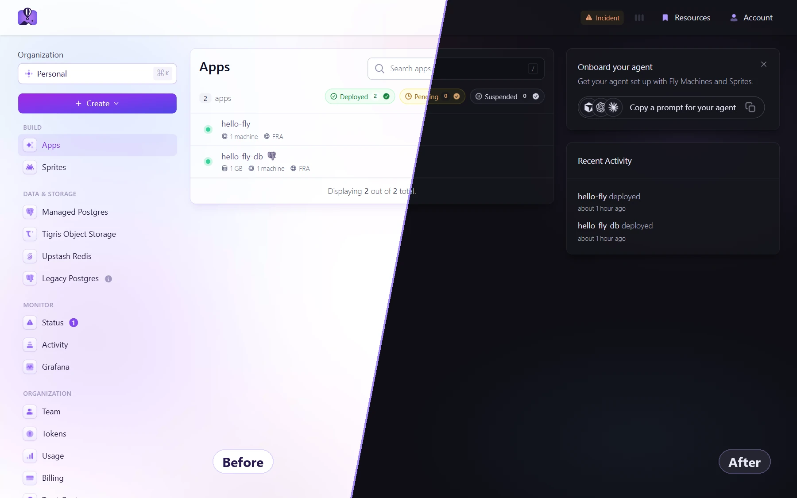
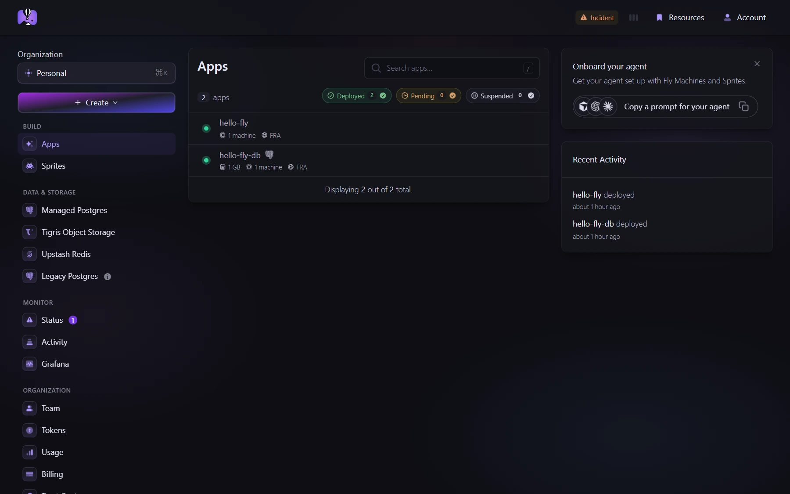
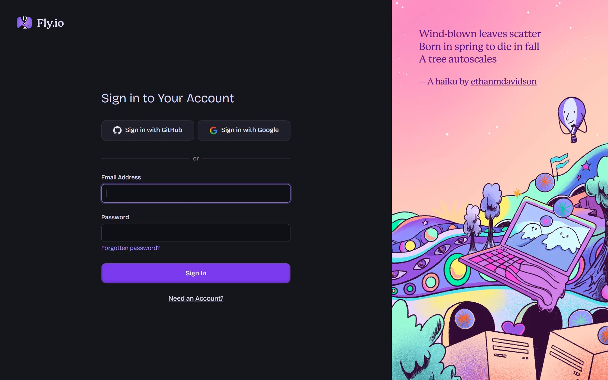

<div align="center">

# Fly.io Dark Mode

**A smooth, purple-tinted dark theme for the [Fly.io](https://fly.io) dashboard.**<br>
Stylus userstyle (UserCSS) · Chrome, Firefox, Edge, Brave, Opera · auto-updates

[](https://raw.githubusercontent.com/rojnwa/fly-io-dark-mode/main/fly-io-dark-mode.user.css)
[](LICENSE)



</div>

Fly.io's dashboard only comes in light mode. This userstyle gives the whole thing (apps, Machines, Managed Postgres, Sprites, billing, tokens, org settings and the sign-in page) a proper dark theme. The colours are calm, the contrast is readable, and Fly's violet brand colour stays in.

## Install

1. Install the **Stylus** browser extension:
   [Chrome / Edge / Brave / Opera / Vivaldi](https://chromewebstore.google.com/detail/stylus/clngdbkpkpeebahjckkjfobafhncgmne) ·
   [Firefox](https://addons.mozilla.org/firefox/addon/styl-us/)
2. Open **[fly-io-dark-mode.user.css](https://raw.githubusercontent.com/rojnwa/fly-io-dark-mode/main/fly-io-dark-mode.user.css)**. Stylus shows its install page.
3. Click **Install style** and open [fly.io/dashboard](https://fly.io/dashboard).

Stylus checks for updates automatically. To update by hand: Stylus manager → **Check for updates**.

<details>
<summary>Manual install (copy &amp; paste)</summary>

Stylus manager → **Write new style** → paste the entire contents of
[`fly-io-dark-mode.user.css`](fly-io-dark-mode.user.css) → **Save**. Stylus reads the
`==UserStyle==` header and sets it up as a UserCSS style.
</details>

## Screenshots

| Apps overview | Sign in |
| --- | --- |
|  |  |

## Features

- **Whole dashboard.** It recolours every colour rule in Fly's stylesheet, so pages you haven't opened yet are dark too.
- **Nothing breaks.** Hover, focus, active and responsive states work as before.
- **Easy on the eyes.** Purple-grey surfaces instead of pure black, soft hairline borders, and a subtle dark version of Fly's pastel background.
- **Readable.** Every text colour class has at least 4.5:1 contrast against the page.
- **Status colours still read.** Deployed, pending, failed and suspended badges, alerts, buttons and running dots keep their meaning.
- **Details handled.** Inputs and browser autofill, tooltips, modals, code blocks (GitHub-dark syntax colours), the SQL editor, date pickers, charts, region maps, native scrollbars (`color-scheme: dark`) and the Fly logo.
- **Only the dashboard.** The style applies only to the Fly.io dashboard URLs. Marketing pages, the blog and [docs.fly.io](https://docs.fly.io) (which has its own dark mode) are left alone.

## Pages covered

`fly.io/dashboard/*` · `fly.io/apps/*` · `fly.io/app/*` (sign-in, sign-up) · `fly.io/user/*` · `fly.io/organizations/*` · `fly.io/tokens` · `fly.io/oauth/*`

## Customize

The palette is listed at the top of the style. In the Stylus editor, search-and-replace a hex value to change it everywhere:

| Role | Colour |
| --- | --- |
| Backdrop | `#0e0e14` |
| Cards / page | `#15151d` |
| Raised surfaces | `#1a1a23` · `#1f1f29` |
| Popovers, tooltips | `#252530` |
| Inputs, code | `#0f0f16` |
| Text · muted · faint | `#e6e7f5` · `#a4a4b3` · `#868695` |
| Accent (Fly violet, lifted) | `#af97ff` |

For permanent changes, edit [`scripts/build.py`](scripts/build.py) and rebuild. That way your changes survive Fly's next stylesheet update.

## How it works

The theme is **generated** from Fly's own CSS, not written by hand:

1. [`scripts/build.py`](scripts/build.py) downloads the current dashboard stylesheet (`/phx/assets/app-<hash>.css`, Tailwind 3 plus Fly's components).
2. It copies every rule that sets a colour, keeping the same selector, the same media query and the same position in the cascade. Only the colour changes, calculated in OKLCH:
   - light surfaces become dark surfaces
   - dark text becomes light text
   - pastel tints become translucent glows
   - hairline borders become soft white borders
   - blocks that are already dark (logs, code) stay dark
3. It adds hand-tuned overrides for Fly's components: buttons, badges, cards, alerts, inputs, tooltips and syntax highlighting.
4. It adds things the site never styles: `color-scheme`, the dashboard backdrop, autofill, charts, maps and the logo.

Because the cascade order matches the original exactly, the theme behaves just like Fly's own light theme.

## Rebuilding after a Fly.io update

When Fly ships a new stylesheet, newly added classes stay light until the theme is regenerated:

```sh
python scripts/build.py              # fetches the live CSS from fly.io
python scripts/build.py --css app.css   # or build from a saved copy
```

The script needs Python 3.9+ and nothing else (standard library only). It prints a warning if a hand-tuned override no longer matches Fly's CSS. The generated file names the stylesheet it was built from, so you can check whether it's up to date.

## Known limitations

- **Grafana metrics** live on `fly-metrics.net`, a separate site. Grafana has its own dark theme: *Profile → Preferences → Interface theme*.
- **Charts** drawn on a canvas are colour-inverted to make their dark labels readable. Series colours may shift slightly.
- **Pictures** (illustrations, empty-state art) are left as they are.

Something looks off? [Open an issue](https://github.com/rojnwa/fly-io-dark-mode/issues/new/choose) with the page path and a screenshot.

## Contributing

Pull requests are welcome. See [CONTRIBUTING.md](CONTRIBUTING.md). In short: change `scripts/build.py`, run it, and commit the regenerated `.user.css`. Please don't edit the generated file by hand.

## License

[MIT](LICENSE) © Roman Wagner

This is an unofficial community project, not affiliated with or endorsed by Fly.io. "Fly.io" and the Fly.io logo belong to their respective owner. The screenshots show the Fly.io dashboard with example data.
